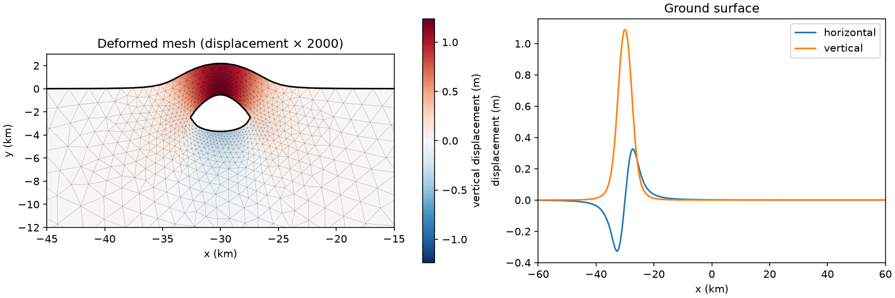
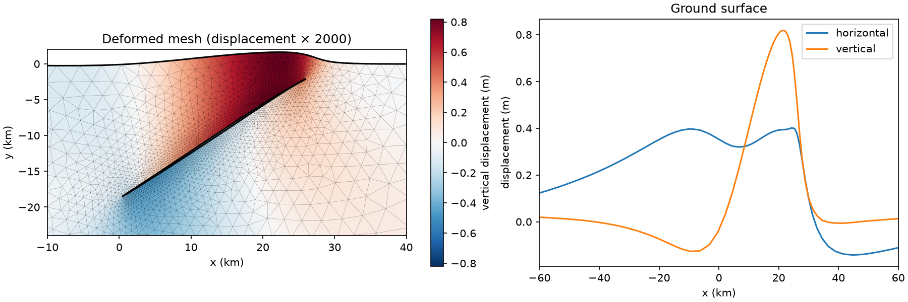

Geophysical cracks and faults with BrokenMesh
=============================================

.. rst-class:: emphasis

    This demo shows how to solve problems whose solution jumps across an
    internal surface of the mesh.  :func:`~.BrokenMesh` opens a labelled
    surface, so that a continuous Galerkin space on the opened mesh can take a
    different value on each side of it.  We use it for two plane-strain
    elasticity problems in a cross-section of the Earth's crust: a magma sill
    loaded by a pressure on its faces, and a fault on which a Lagrange
    multiplier on a :func:`~.Submesh` imposes a prescribed slip.

    The demo was contributed by `Pablo Brubeck
    <mailto:brubeck@protonmail.com>`__.

The domain, the material and the boundary conditions follow `Step 5 of the 2D
reverse fault example
<https://pylith.readthedocs.io/en/v5.0.2/user/examples/reverse-2d/step05-onefault.html>`__
in the PyLith manual :cite:`PyLithManual`, and the fault slip is imposed with
the formulation of :cite:`Aagaard2013`.

The mesh
--------

The domain is a cross-section of the crust that is 200 km wide and 100 km
deep, with the ground surface at :math:`y = 0`.  The Gmsh file
:demo:`crust.geo <crust.geo>` embeds two curves in the mesh: a horizontal
sill and a fault that dips at 30°.  Both curves end inside the domain.
Lengths are in km, displacements in m, and elastic moduli in GPa, so that
stresses are in MPa.

In parallel, :func:`~.BrokenMesh` needs both cells next to each labelled facet
on the process that owns the facet, so we distribute the mesh with a
``RIDGE`` overlap.

.. code-block:: python

   from firedrake import *

   dparams = {"overlap_type": (DistributedMeshOverlapType.RIDGE, 1)}
   mesh = Mesh("crust.msh", distribution_parameters=dparams)
   bottom_id, sides_id, surface_id, sill_id, fault_id = 1, 2, 3, 4, 5

The model
---------

The displacement :math:`u` satisfies the equations of linear elasticity

.. math::

   -\nabla\cdot\sigma(u) = 0 \quad\text{in } \Omega\setminus\Gamma,
   \qquad
   \sigma(u) = \lambda(\nabla\cdot u)I + 2\mu\,\varepsilon(u),
   \qquad
   \varepsilon(u) = \tfrac12(\nabla u + \nabla u^T),

where :math:`\Gamma` is the crack.  The sides and the bottom of the domain
are rollers, on which the normal displacement is zero, and the ground surface
is free of traction.  Both problems are small, so we solve them with a sparse
direct method.

.. code-block:: python

   mu = Constant(22.5)
   lambda_ = Constant(25.0)

   def epsilon(u):
       return sym(grad(u))

   def sigma(u):
       return lambda_ * div(u) * Identity(2) + 2 * mu * epsilon(u)

   def roller_bcs(V):
       return [DirichletBC(V.sub(0), 0, sides_id),
               DirichletBC(V.sub(1), 0, bottom_id)]

   lu = {
       "mat_type": "aij",
       "ksp_type": "preonly",
       "pc_type": "lu",
       "pc_factor_mat_solver_type": "mumps",
   }

An inflating magma sill
-----------------------

We open only the sill.  The fault stays closed and has no effect in this
part.

.. code-block:: python

   sill_broken_mesh = BrokenMesh(mesh, sill_id)
   V = VectorFunctionSpace(sill_broken_mesh, "CG", 1)
   u = TrialFunction(V)
   v = TestFunction(V)

The magma pushes on the two faces :math:`\Gamma^\pm` of the sill with the
overpressure :math:`p = 5` MPa, so the traction on each face is
:math:`\sigma n = -p\,n`, where :math:`n` is the outward normal of
:math:`\Omega\setminus\Gamma`.  This is a natural boundary condition: find
:math:`u \in V` such that

.. math::

   \int_{\Omega\setminus\Gamma} \sigma(u):\varepsilon(v)\,\mathrm{d}x
   = -\int_{\Gamma^+\cup\,\Gamma^-} p\,n\cdot v\,\mathrm{d}s
   \quad\text{for all } v \in V.

The two faces are exterior facets of the broken mesh, and they keep the label
of the sill.  Therefore ``ds(sill_id)`` integrates over both faces.

.. code-block:: python

   pressure = Constant(5.0)
   n = FacetNormal(sill_broken_mesh)
   a = inner(sigma(u), epsilon(v)) * dx
   L = -pressure * inner(n, v) * ds(sill_id)

   sill_displacement = Function(V, name="displacement")
   solve(a == L, sill_displacement, bcs=roller_bcs(V), solver_parameters=lu)

The figure shows the deformed broken mesh near the sill and the displacement
of the ground surface.  The code that draws the figures is in the appendix.

The magma opens the sill, lifts the ground above it by approximately 1 m,
and pushes the ground outwards on both sides.

Prescribed slip on a fault
--------------------------

Now we open only the fault :math:`\Gamma`, and we prescribe the slip of an
earthquake on it with a Lagrange multiplier :math:`\lambda_\Gamma`.  The
displacement is in a space :math:`V` on the broken mesh.  The multiplier
lives only on the fault, so it is in a space :math:`M` on a
:func:`~.Submesh` of the parent mesh.

:func:`~.BrokenMesh` does not duplicate the vertices at the two tips of the
fault, so the jump of a function in :math:`V` is continuous, piecewise linear,
and zero at the tips.  We take :math:`M` to be the same space: vector-valued,
continuous, piecewise linear functions on the fault that are zero at its tips.
The ``DirichletBC`` on the boundary of the fault submesh, which consists of
the two tips, removes the multiplier degrees of freedom that no displacement
would constrain.

.. code-block:: python

   fault_broken_mesh = BrokenMesh(mesh, fault_id)
   fault_submesh = Submesh(mesh, 1, fault_id)

   V = VectorFunctionSpace(fault_broken_mesh, "CG", 1)
   M = VectorFunctionSpace(fault_submesh, "CG", 1)
   Z = V * M
   u, multiplier = TrialFunctions(Z)
   v, eta = TestFunctions(Z)

   bcs = [*roller_bcs(Z.sub(0)), DirichletBC(Z.sub(1), 0, "on_boundary")]

UFL chooses the ``'+'`` and ``'-'`` sides of each interior facet
independently, so the jump :math:`[\![u]\!] = u^+ - u^-` can change sign from one
facet to the next.  To pair the jump with a continuous multiplier, we rotate
it into the frame of the fault,

.. math::

   R = \begin{pmatrix} (n^+)^T \\ (t^+)^T \end{pmatrix},
   \qquad t^+ = n^{+\perp},

where :math:`n^+` is the unit normal of the parent mesh and :math:`\perp`
rotates a vector by 90° counterclockwise.  If the two sides are exchanged,
both :math:`[\![u]\!]` and :math:`R` change sign, so :math:`R[\![u]\!]`, which contains
the normal and the tangential jump, does not depend on the choice of UFL.

We prescribe no opening and a reverse slip with an elliptical profile,

.. math::

   R[\![u]\!] = \begin{pmatrix} 0 \\ s \end{pmatrix},
   \qquad
   s = s_0\sqrt{1 - (\xi/a)^2},

where :math:`\xi` is the distance from the centre of the fault,
:math:`a = 15` km is its half-width, and :math:`s_0 = 2` m.

.. code-block:: python

   n = FacetNormal(mesh)("+")
   R = as_tensor([n, perp(n)])

   half_width = Constant(15.0)
   peak_slip = Constant(2.0)
   fault_centre = Constant([7.5 * 3 ** 0.5, -10.5])
   xi = sqrt(inner(SpatialCoordinate(mesh) - fault_centre, SpatialCoordinate(mesh) - fault_centre))
   slip = as_vector([0, peak_slip * sqrt(1 - (xi / half_width) ** 2)])

The saddle point problem is: find :math:`(u, \lambda_\Gamma) \in V\times M`
such that

.. math::

   \begin{aligned}
   \int_{\Omega\setminus\Gamma} \sigma(u):\varepsilon(v)\,\mathrm{d}x
   + \int_\Gamma \lambda_\Gamma\cdot R[\![v]\!]\,\mathrm{d}s &= 0
   &&\text{for all } v \in V, \\
   \int_\Gamma R[\![u]\!]\cdot\eta\,\mathrm{d}s
   &= \int_\Gamma \begin{pmatrix} 0 \\ s \end{pmatrix}\cdot\eta\,\mathrm{d}s
   &&\text{for all } \eta \in M.
   \end{aligned}

Integration by parts in the first equation shows that
:math:`\lambda_\Gamma = -R\,\sigma(u)n^+` is the change of traction on the
fault, in the frame of the fault.

The fault integrals couple three meshes.  The ``dS`` measure of the parent
mesh selects the fault facets, and ``intersect_measures`` evaluates the
multiplier on the cells of the fault submesh and the displacement on both
sides of the corresponding facets of the broken mesh.  The slip is not a
polynomial, so we fix the quadrature degree.

.. code-block:: python

   dS_fault = dS(domain=mesh, subdomain_id=fault_id, degree=4,
                 intersect_measures=(dx(fault_submesh), dS(domain=fault_broken_mesh)))

   a = (inner(sigma(u), epsilon(v)) * dx(fault_broken_mesh)
        + inner(multiplier, dot(R, jump(v))) * dS_fault
        + inner(dot(R, jump(u)), eta) * dS_fault)
   L = inner(slip, eta) * dS_fault

   solution = Function(Z)
   solve(a == L, solution, bcs=bcs, solver_parameters=lu)
   fault_displacement, traction_change = solution.subfunctions

The figure shows the deformed broken mesh near the fault and the displacement
of the ground surface.

The vertical displacement jumps across the fault.  The earthquake lifts the
hanging wall and moves it towards the footwall, and the ground on both sides
of the uplift subsides a little.

The jump of the discrete displacement is in :math:`M`, so the constraint
holds exactly: :math:`R[\![u]\!]` is the :math:`L^2` projection of the prescribed
jump onto :math:`M`.  We check that the residual of the constraint is zero up
to rounding errors.

.. code-block:: python

   residual = assemble(inner(dot(R, jump(fault_displacement)) - slip, TestFunction(M)) * dS_fault)
   DirichletBC(M, 0, "on_boundary").zero(residual)
   with residual.dat.vec_ro as r:
       print(f"Constraint residual: {r.norm():.2e}")

An elliptical slip profile is the slip of a crack in an infinite elastic
solid with a uniform drop of shear stress
:math:`\Delta\tau = \mu s_0 / (2(1 - \nu)a)`, where :math:`\nu` is the Poisson
ratio.  The ground surface and the boundaries of the domain change the
traction a little, so the mean shear component of the multiplier is close to,
but not equal to, :math:`-\Delta\tau`.

.. code-block:: python

   nu = lambda_ / (2 * (lambda_ + mu))
   stress_drop = float(mu * peak_slip / (2 * (1 - nu) * half_width))
   fault_length = assemble(Constant(1) * dx(fault_submesh))
   mean_shear = assemble(traction_change[1] * dx(fault_submesh)) / fault_length
   print(f"Stress drop: {-mean_shear:.2f} MPa (infinite solid: {stress_drop:.2f} MPa)")

Appendix: plotting
------------------

For each problem, we plot the deformed broken mesh near the crack, coloured
with the vertical displacement, and the displacement of the ground surface.
To deform the mesh, we move its coordinates by the magnified displacement
and restore them afterwards.  A :func:`~.Submesh` of the broken mesh extracts
the ground surface.

.. code-block:: python

   from firedrake.pyplot import plot, triplot, tripcolor
   import matplotlib.pyplot as plt

   def plot_solution(u, window, filename, magnification=2000):
       broken_mesh = u.function_space().mesh()
       vertical = Function(FunctionSpace(broken_mesh, "CG", 1)).interpolate(u[1])
       surface_mesh = Submesh(broken_mesh, 1, surface_id)
       surface_space = VectorFunctionSpace(surface_mesh, "CG", 1)
       surface_u = Function(surface_space).interpolate(u)

       fig, axes = plt.subplots(1, 2, figsize=(12, 4), layout="constrained")
       X = Function(broken_mesh.coordinates)
       broken_mesh.coordinates.assign(X + magnification * 1.0e-3 * u)
       limit = abs(vertical.dat.data_ro).max()
       colours = tripcolor(vertical, axes=axes[0], cmap="RdBu_r", vmin=-limit, vmax=limit)
       triplot(broken_mesh, axes=axes[0],
               interior_kw={"linewidths": 0.1, "alpha": 0.5},
               boundary_kw={"colors": ["black"] * 5})
       broken_mesh.coordinates.assign(X)
       axes[0].set_xlim(window[:2])
       axes[0].set_ylim(window[2:])
       axes[0].set_aspect("equal")
       axes[0].set_xlabel("x (km)")
       axes[0].set_ylabel("y (km)")
       axes[0].set_title(f"Deformed mesh (displacement × {magnification})")
       fig.colorbar(colours, ax=axes[0], label="vertical displacement (m)")

       plot(surface_u.sub(0), axes=axes[1], label="horizontal")
       plot(surface_u.sub(1), axes=axes[1], label="vertical")
       axes[1].set_xlim(-60, 60)
       axes[1].set_xlabel("x (km)")
       axes[1].set_ylabel("displacement (m)")
       axes[1].set_title("Ground surface")
       axes[1].legend()
       fig.savefig(filename, dpi=150)

   plot_solution(sill_displacement, (-45, -15, -12, 3), "fault_elasticity_sill.png")
   plot_solution(fault_displacement, (-10, 40, -24, 2), "fault_elasticity_thrust.png")

A Python script version of this demo is available as
:demo:`fault_elasticity.py <fault_elasticity.py>`.

.. rubric:: References

.. bibliography:: demo_references.bib
   :filter: docname in docnames
