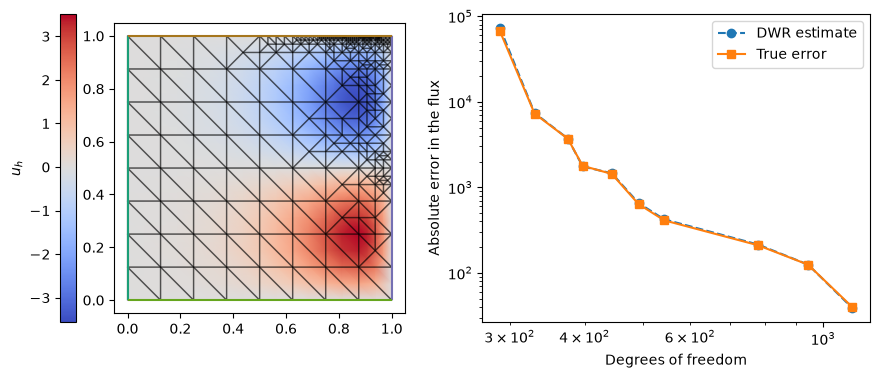
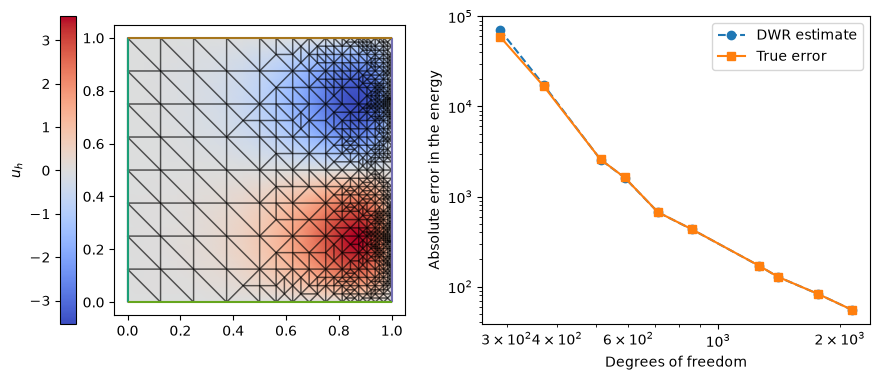

Goal-oriented adaptivity for stationary boundary value problems
===============================================================

.. rst-class:: emphasis

    The dual-weighted residual (DWR) method designs global and local error
    estimators for a goal functional :math:`J(u)`, where :math:`u` solves a
    partial differential equation. Deriving DWR for a
    specific problem usually takes substantial expertise: the appropriate
    adjoint equation, the residual formulation, and so on. This demo shows
    how Firedrake implements DWR automatically for stationary boundary value
    problems.

    The demo was contributed by `Patrick Farrell
    <mailto:patrick.farrell@maths.ox.ac.uk>`__, based on the MSc project of
    `Joseph Flood <mailto:josephdflood01@gmail.com>`__.

The dual-weighted residual method :cite:`Becker:2001` designs global and local
error estimators for the error in a goal functional :math:`J(u)`. While
implementing DWR by hand involves substantial expertise, the high-level
symbolic UFL representation of the problem permits the *automation* of DWR
:cite:`Rognes:2013`.

Here we apply DWR to a nonlinear stationary boundary value problem, the
:math:`p`-Laplacian:

.. math::
    -\nabla \cdot \left( |\nabla u|^{p-2} \nabla u \right) = f \text{ in } \Omega, \quad u = 0 \text{ on } \partial \Omega.

We solve it on the unit square with a known analytical solution, so that we can
compute effectivity indices for our error estimates. Any Firedrake mesh can be
refined in place, so we start from a uniform mesh:

.. code-block:: python

  from firedrake import *

  mesh = UnitSquareMesh(8, 8)

  degree = 2
  V = FunctionSpace(mesh, "CG", degree)
  x, y = SpatialCoordinate(mesh)

  p = Constant(5)
  u_exact = x*(1-x)*y*(1-y)*exp(2*pi*x)*cos(pi*y)
  f = -div(inner(grad(u_exact), grad(u_exact))**((p-2)/2) * grad(u_exact))

The manufactured solution vanishes on all four edges, so the boundary condition
is homogeneous. The :math:`p`-Laplacian is the Euler--Lagrange equation of the
energy

.. math::
    E(u) = \frac{1}{p} \int_\Omega |\nabla u|^p \,\mathrm{d}x - \int_\Omega f u \,\mathrm{d}x,

so we write down :math:`E` and ask UFL for the residual :math:`F` as its
derivative. The integrand is not polynomial, so we ask for a richer quadrature
rule than the degree of the space alone would suggest:

.. code-block:: python

  u = Function(V, name="Solution")

  quadrature = {"degree": 2*degree + 2}
  E = (1/p)*inner(grad(u), grad(u))**(p/2)*dx(**quadrature) - inner(f, u)*dx(**quadrature)
  F = derivative(E, u)
  bcs = DirichletBC(V, 0, "on_boundary")

The problem is strongly nonlinear, so we need a good initial guess. A constant
initial guess, such as :math:`u = 0`, is a poor choice: the diffusivity
:math:`|\nabla u|^{p-2}` is zero there, and so is the Jacobian. We solve the
Poisson problem :math:`-\Delta w = f` with the same boundary condition instead:

.. code-block:: python

  v = TestFunction(V)
  w = TrialFunction(V)
  solve(inner(grad(w), grad(v))*dx == inner(f, v)*dx(**quadrature), u, bcs)

The forcing :math:`f` was computed for :math:`p = 5`, so the Poisson solution
has the wrong magnitude. We scale :math:`w` by the value of :math:`c` that
minimises :math:`E(c w)`, which is
:math:`c = \left(\int_\Omega f w \,\mathrm{d}x \big/ \int_\Omega |\nabla w|^p \,\mathrm{d}x\right)^{1/(p-1)}`:

.. code-block:: python

  c = (assemble(inner(f, u)*dx(**quadrature))
       / assemble(inner(grad(u), grad(u))**(p/2)*dx(**quadrature)))**(1/(float(p) - 1))
  u.assign(c*u)

We keep a copy of the initial guess, so that we can start each adaptive solve
from it:

.. code-block:: python

  initial_guess = u.copy(deepcopy=True)

We solve the nonlinear problem with a trust-region Newton method. This method
uses the energy :math:`E` as an objective to accept or reject each step. We
solve each linear system with a sparse LU factorisation from MUMPS. The DWR
estimate includes contributions from discretisation and from solving the
nonlinear system to a finite tolerance. We use a tight relative tolerance so
that the discretisation error dominates in this example.

.. code-block:: python

  solver_parameters = {
      "snes_type": "newtontr",
      "snes_atol": 1.0e-6,
      "snes_rtol": 1.0e-8,
      "ksp_type": "preonly",
      "pc_type": "lu",
      "pc_factor_mat_solver_type": "mumps",
  }

Now the adaptive loop itself. ``snes_grid_sequence`` is the *maximum* number
of SOLVE--ESTIMATE--MARK--REFINE cycles. ``goal_atol`` stops it early once the
estimated error in the goal is small enough, and ``goal_rtol`` gives a tolerance
relative to the absolute value of the current goal functional on the
uncorrected, non-enriched solution.  If both tolerances are set, the loop stops
when the estimate falls below the larger threshold.  ``goal_marking_fraction``
sets the threshold for marking a cell as a fraction of the largest error
indicator, and ``goal_monitor`` reports the estimate at each cycle:

.. code-block:: python

  solver_parameters.update({
      "snes_grid_sequence": 10,
      "goal_atol": 5.0e-3,
      "goal_marking_fraction": 0.5,
      "goal_monitor": None,
  })

Let :math:`z` be the solution of the dual problem
:math:`F'(u)[v, z] = J'(u)[v]` for all :math:`v`. The marker solves the primal
and dual problems again in a space of one degree higher, and it uses these
solutions in place of :math:`u` and :math:`z`. It estimates the error in the
goal with the mean of the primal residual weighted by the dual error and the
adjoint residual weighted by the primal error :cite:`Endtmayer:2024`:

.. math::

    J(u) - J(u_h) \approx \frac{1}{2} \rho(u_h; z - z_h)
    + \frac{1}{2} \rho^*(u_h, z_h; u - u_h) + \rho(u_h; z_h),

where :math:`\rho(u_h; v) = -F(u_h; v)` is the primal residual and
:math:`\rho^*(u_h, z_h; v) = J'(u_h)[v] - F'(u_h)[v, z_h]` is the adjoint
residual. The last term is the error from solving the nonlinear system
inexactly. The remainder of this estimate is cubic in the errors. The marker
localises both residuals by projecting them onto cell-bubble and facet-bubble
spaces. The resulting local problems are diagonal because each has one degree
of freedom per cell or facet.

The adaptive loop is handled inside ``solve``.  It runs the configured
SOLVE--ESTIMATE--MARK--REFINE cycle, and the marking callback supplies the
cells to refine.  The ``objective`` argument gives the energy to the
trust-region method.  We also pass the exact solution, which lets the monitor
report the true error and an effectivity index.  Of course, this is not needed
in general.

``solve`` returns the solution on the final adapted mesh, in the original
degree-2 space. ``marker.estimates`` records the estimates in mesh order. The
last entry gives the most recent estimate :math:`\eta` of the error in the
goal. If the grid sequence reaches its refinement limit, this estimate comes
from the mesh before the final refinement. At each cycle, the monitor reports
the goal value, the errors, and the effectivity index given by

.. math::

    I = \frac{\eta}{J(u) - J(u_h)}.

If the algebraic error exceeds the discretisation error, the marker prints

.. code-block:: text

    DWR: the solver error exceeds the discretisation error. Tighten the solver tolerances.

Tighten ``snes_rtol`` and ``snes_atol`` if the algebraic error limits the
accuracy of the goal.

We put the adaptive solve and the plots in a helper function, so that we can
compare different goals. Each goal starts from the same initial mesh and the
same initial guess. The adaptive solve adds each refined mesh on top of the
mesh hierarchy of the initial mesh. A later solve from the same mesh would
reuse those refined meshes, so the helper first starts a new
:func:`~.MeshHierarchy` from the initial mesh. The left plot shows the
solution, with the adapted mesh drawn on top of it with transparent lines. The
right plot compares the magnitude of the DWR estimate with the magnitude of the
true error in the goal on each mesh that the monitor reports:

.. code-block:: python

  import matplotlib.pyplot as plt
  from firedrake.pyplot import tripcolor, triplot

  def solve_adaptively(goal, name):
      # Restart from the initial mesh and the initial guess.
      MeshHierarchy(mesh)
      u.assign(initial_guess)

      # Solve on a sequence of meshes that are adapted for the goal.
      marker = GoalOrientedMarker(goal, exact_solution=u_exact)
      uh = solve(F == 0, u, bcs, objective=E, solver_parameters=solver_parameters,
                 marking_callback=marker)

      # Plot the solution and the final adapted mesh.
      fig, (solution_axes, error_axes) = plt.subplots(1, 2, figsize=(11, 4))
      colours = tripcolor(uh, axes=solution_axes, cmap="coolwarm")
      fig.colorbar(colours, ax=solution_axes, location="left", label="$u_h$")
      triplot(uh.function_space().mesh().unique(), axes=solution_axes,
              interior_kw={"alpha": 0.4})
      solution_axes.set_aspect("equal")

      # Plot the estimated and the true errors in the goal on each mesh.
      dofs = [estimate.num_dofs for estimate in marker.estimates]
      estimated_errors = [abs(estimate.error_estimate) for estimate in marker.estimates]
      true_errors = [abs(estimate.true_error) for estimate in marker.estimates]
      error_axes.loglog(dofs, estimated_errors, "o--", label="DWR estimate")
      error_axes.loglog(dofs, true_errors, "s-", label="True error")
      error_axes.set_xlabel("Degrees of freedom")
      error_axes.set_ylabel(f"Absolute error in the {name}")
      error_axes.legend()
      fig.savefig(f"goal_oriented_nonlinear_p_laplacian_{name}.png", bbox_inches="tight")

Our first goal is the net outward flux through the top boundary. The flux
vector is :math:`\mathbf{q}(u) = -|\nabla u|^{p-2}\nabla u`, so the goal is
:math:`J(u) = \int_{\Gamma_{\mathrm{top}}} \mathbf{q}(u) \cdot n\,\mathrm{d}s`.
The manufactured solution gives a negative value, which indicates net inflow.
``UnitSquareMesh`` numbers the top boundary ``4``. We use higher quadrature on
this boundary to evaluate the reference flux accurately:

.. code-block:: python

  flux = -inner(grad(u), grad(u))**((p-2)/2) * grad(u)
  n = FacetNormal(mesh)
  Jflux = inner(flux, n)*ds(4, degree=16)
  solve_adaptively(Jflux, "flux")

The finest cells lie near the top boundary, where the goal functional is
evaluated, and along the right side of the domain.

Our second goal is the energy :math:`E` itself. The residual is the derivative
of the energy, so the dual problem has the right-hand side
:math:`J'(u) = F(u)`, which is zero at the solution. Thus the dual solutions
:math:`z` and :math:`z_h` are zero, and so is the primal residual weighted by
the dual error. The adjoint residual is then :math:`\rho^*(u_h, 0; v) = F(u_h; v)`,
and the estimate reduces to

.. math::

    E(u) - E(u_h) \approx \frac{1}{2} F(u_h; u - u_h).

.. code-block:: python

  solve_adaptively(E, "energy")

The energy measures the error over the whole domain, so the marker refines the
mesh where the gradient of the solution is large, near the right boundary.

A python script version of this demo can be found :demo:`here
<goal_oriented_nonlinear_p_laplacian.py>`.

.. rubric:: References

.. bibliography:: demo_references.bib
   :filter: docname in docnames
