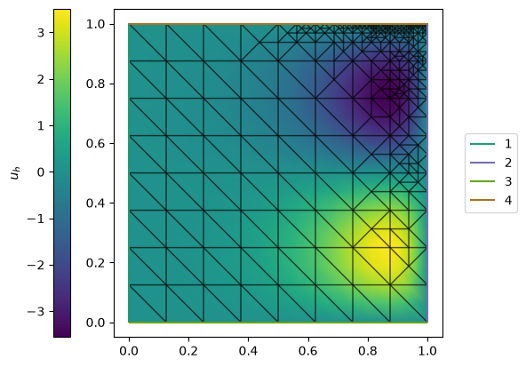

Goal-based adaptivity for stationary boundary value problems
============================================================

.. rst-class:: emphasis

    The dual-weighted residual (DWR) method designs global and local error
    estimators for a goal functional :math:`J(u)`, where :math:`u` solves a
    partial differential equation. Deriving DWR for a
    specific problem usually takes substantial expertise: the appropriate
    adjoint equation, the residual formulation, and so on. This demo shows
    how Firedrake implements DWR automatically for stationary boundary value
    problems.

    The demo was contributed by `Patrick Farrell
    <mailto:patrick.farrell@maths.ox.ac.uk>`__, based on the MSc project of
    `Joseph Flood <mailto:josephdflood01@gmail.com>`__.

The dual-weighted residual method :cite:`Becker:2001` designs global and local
error estimators for the error in a goal functional :math:`J(u)`. While
implementing DWR by hand involves substantial expertise, the high-level
symbolic UFL representation of the problem permits the *automation* of DWR
:cite:`Rognes:2013`.

Here we apply DWR to a nonlinear stationary boundary value problem, the
:math:`p`-Laplacian:

.. math::
    -\nabla \cdot \left( |\nabla u|^{p-2} \nabla u \right) = f \text{ in } \Omega, \quad u = 0 \text{ on } \partial \Omega.

We solve it on the unit square with a known analytical solution, so that we can
compute effectivity indices for our error estimates. Any Firedrake mesh can be
refined in place, so we start from a uniform mesh:

.. code-block:: python

  from firedrake import *

  mesh = UnitSquareMesh(8, 8)

  degree = 2
  V = FunctionSpace(mesh, "CG", degree)
  x, y = SpatialCoordinate(mesh)

  p = Constant(5)
  u_exact = x*(1-x)*y*(1-y)*exp(2*pi*x)*cos(pi*y)
  f = -div(inner(grad(u_exact), grad(u_exact))**((p-2)/2) * grad(u_exact))

The manufactured solution vanishes on all four edges, so the boundary condition
is homogeneous. The problem is strongly nonlinear, so for the purposes of this
demo we cheat and start from an initial guess close to the exact solution. The
integrand is not polynomial, so we ask for a richer quadrature rule than the
degree of the space alone would suggest:

.. code-block:: python

  u = Function(V, name="Solution")
  u.interpolate(0.99*u_exact)

  v = TestFunction(V)
  quadrature = {"degree": 2*degree + 2}
  F = (inner(inner(grad(u), grad(u))**((p-2)/2) * grad(u), grad(v))*dx(**quadrature)
       - inner(f, v)*dx(**quadrature))
  bcs = DirichletBC(V, 0, "on_boundary")

To apply goal-based adaptivity we need a goal functional. Here we use the
integral of the normal derivative of the solution over the top boundary, which
`UnitSquareMesh` numbers ``4``:

.. code-block:: python

  n = FacetNormal(mesh)
  J = inner(grad(u), n)*ds(4)

The estimate splits in two: the error committed by discretising, and the error
committed by not solving the algebraic system exactly. Because DWR measures
that algebraic error too, a very coarse tolerance on the nonlinear solver
costs us nothing:

.. code-block:: python

  solver_parameters = {
      "snes_atol": 1.0e-6,
      "snes_rtol": 1.0e-1,
      "snes_linesearch_type": "l2",
      "ksp_type": "preonly",
      "pc_type": "lu",
  }

The DWR machinery localises the residual by projecting it onto cell-bubble and
facet-bubble spaces.  The resulting local problems are diagonal because each
has one degree of freedom per cell or facet.

Now the adaptive loop itself. ``snes_grid_sequence`` is the *maximum* number
of SOLVE--ESTIMATE--MARK--REFINE cycles. ``goal_atol`` stops it early once the
estimated error in the goal is small enough, and ``goal_rtol`` gives a tolerance
relative to the absolute value of the current goal functional on the
uncorrected, non-enriched solution.  If both tolerances are set, the loop stops
when the estimate falls below the larger threshold.  ``goal_marking_fraction``
sets the threshold for marking a cell as a fraction of the largest error
indicator, and ``goal_monitor`` reports the estimate at each cycle:

.. code-block:: python

  solver_parameters.update({
      "snes_grid_sequence": 10,
      "goal_atol": 5.0e-3,
      "goal_marking_fraction": 0.5,
      "goal_monitor": None,
  })

The adaptive loop is handled inside the solver.  It runs the configured
SOLVE--ESTIMATE--MARK--REFINE cycle, and the marking callback supplies the
cells to refine.  We also pass the exact solution, which lets the monitor
report the true error and an effectivity index.  Of course, this is not needed
in general:

.. code-block:: python

  initial_dofs = V.dim()
  problem = NonlinearVariationalProblem(F, u, bcs)
  marker = GoalOrientedMarker(J, exact_solution=u_exact)
  solver = NonlinearVariationalSolver(
      problem,
      solver_parameters=solver_parameters,
      marking_callback=marker,
  )
  uh = solver.solve()

``solver.solve()`` returns the solution on the final adapted mesh, in the
original degree-2 space. ``marker.estimates`` records the estimates in mesh
order. The last entry gives the most recent estimate :math:`\eta` of the error
in the goal. If the grid sequence reaches its refinement limit, this estimate
comes from the mesh before the final refinement:

.. code-block:: python

  print(f"degrees of freedom: {initial_dofs} -> {uh.function_space().dim()}")
  print(f"error estimate: {marker.estimates[-1].error_estimate:.6e}")

In this run, the solver uses all ten refinements. The magnitude of the last
estimate is about :math:`2.5 \times 10^{-2}`, above ``goal_atol``. The
effectivity indices

.. math::

    I = \frac{\eta}{J(u) - J(u_h)}

printed by ``goal_monitor`` range from about :math:`0.82` to :math:`1.26`.

The monitor reports the discretisation and algebraic errors separately. If the
algebraic error exceeds the discretisation error, the marker prints

.. code-block:: text

    DWR: the solver error exceeds the discretisation error. Tighten the solver tolerances.

Tighten ``snes_rtol`` and ``snes_atol`` if the algebraic error limits the
accuracy of the goal.

Finally we plot the adapted mesh. The finest cells lie near the top boundary,
where the goal functional is evaluated, and along the right side of the domain:

.. code-block:: python

  import matplotlib.pyplot as plt
  from firedrake.pyplot import triplot

  fig, axes = plt.subplots()
  triplot(uh.function_space().mesh().unique(), axes=axes)
  axes.set_aspect("equal")
  axes.legend(loc="center left", bbox_to_anchor=(1.05, 0.5))
  fig.savefig("goal_oriented_nonlinear_p_laplacian_mesh.png", bbox_inches="tight")

The estimator used here weights the primal residual by the dual error. Richer
variants exist. Symmetrising the estimate with the adjoint residual leaves a
remainder cubic in the errors rather than quadratic :cite:`Endtmayer:2024`.
That costs two further solves per cycle.

A python script version of this demo can be found :demo:`here
<goal_oriented_nonlinear_p_laplacian.py>`.

.. rubric:: References

.. bibliography:: demo_references.bib
   :filter: docname in docnames
