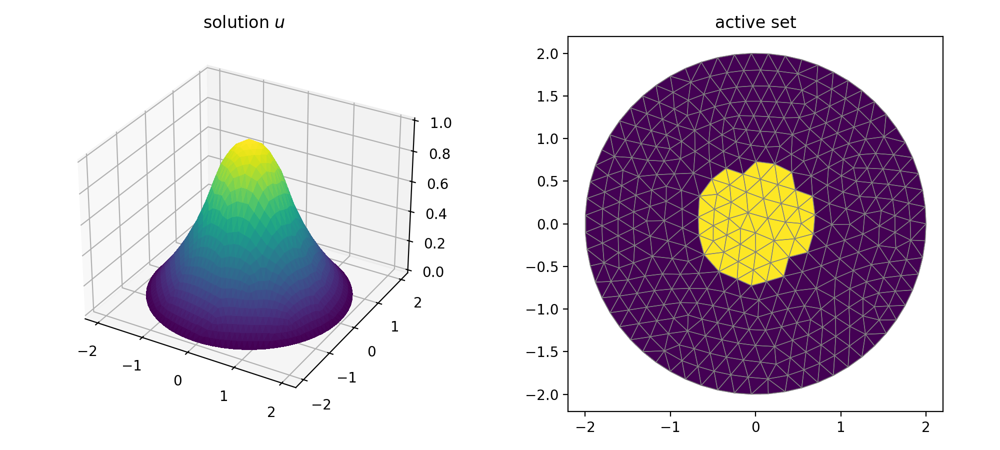
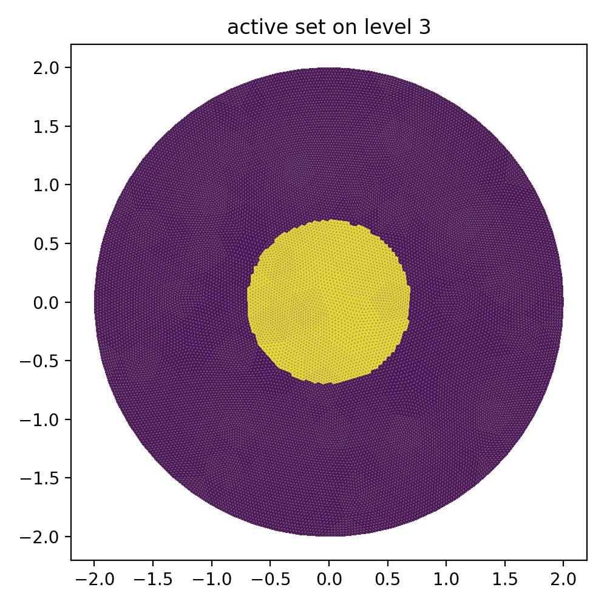

Active-set and Newton-multigrid methods on an obstacle problem
==============================================================

.. rst-class:: emphasis

    This demo solves the classical obstacle problem for an elastic membrane on a disc. The solution
    is constrained to lie on or above an obstacle, and the region where the membrane touches the
    obstacle is not known in advance. The problem is a complementarity problem in strong form and a
    variational inequality (VI) in weak form. The discretization uses first-order Lagrange elements.
    The discrete problem is solved by an active set method, the reduced space Newton method from PETSc.
    We also apply a grid-sequencing loop and solve the linear problems with algebraic multigrid.

    The demo was contributed by `Ed Bueler <mailto:elbueler@alaska.edu>`__.

The problem
-----------

An elastic membrane has height :math:`u(x,y)` over a region :math:`\Omega` in the plane. Its edge
is attached to a frame at height :math:`g` on the boundary :math:`\partial\Omega`. A rigid
obstacle with height :math:`\psi(x,y)` is under the membrane, so the membrane must satisfy
:math:`u \ge \psi`. We assume that there is no load on the membrane. Where the membrane is above
the obstacle it solves the Laplace equation, and elsewhere it touches the obstacle:

.. math::

   -\nabla^2 u &= 0 \quad \text{where } u > \psi, \\
             u &= \psi \quad \text{otherwise}, \\
             u &= g \quad \text{on } \partial\Omega.

These equations will not actually determine the membrane position because the *inactive set*
where the Laplace equation applies is an unknown aspect of the solution.
This set is the :math:`\{x:u(x) > \psi(x)\}`.  Its complement is the set where the constraint
is *active*, namely :math:`\{u = \psi\}`.

The boundary between the two sets is the *free boundary*.  Along the free boundary the membrane
is tangent to the obstacle, so both :math:`u = \psi` and :math:`\nabla u = \nabla \psi` hold there.

The strong form, which states conditions applying almost everywhere on :math:`\Omega`,
is a nonlinear *complementarity problem* (CP) :cite:`KinderlehrerStampacchia:1980`:

.. math::

    u - \psi &\ge 0, \\
   -\nabla^2 u &\ge 0, \\
   (u - \psi)(-\nabla^2 u) &= 0.

The third condition says that at each point in :math:`\Omega` either the Laplace equation
holds or the membrane touches the obstacle.

The weak form of this problem is a *variational inequality* (VI) :cite:`KinderlehrerStampacchia:1980`. Let

.. math::

   K = \left\{ v \in H^1(\Omega) \,:\, v \ge \psi \text{ and } v = g \text{ on } \partial\Omega \right\}

be the closed and convex set of admissible membrane displacement functions. Then :math:`u \in K` solves

.. math::

   \int_\Omega \nabla u \cdot \nabla (v - u) \, \mathrm{d}x \ge 0 \quad \text{for all } v \in K.

This VI is also the first-order condition for the minimization of the energy
:math:`\frac{1}{2} \int_\Omega |\nabla v|^2 \, \mathrm{d}x` over :math:`K`. The VI has a
unique solution :cite:`KinderlehrerStampacchia:1980{Theorem 2.1}`.

Specific example with an exact solution
---------------------------------------

For the example here the domain is the disc :math:`\Omega` of radius 2.
Let :math:`r = \sqrt{x^2 + y^2}`.  The obstacle is the upper unit hemisphere,
but continued outside the radius :math:`r_0 = 0.9` by the linear function
that makes :math:`\psi` continuously differentiable:

.. math::

   \psi(r) = \begin{cases} \sqrt{1 - r^2}, & r \le r_0, \\
                           \psi(r_0) + \psi'(r_0)(r - r_0), & r > r_0. \end{cases}

The exact solution can be found because it is radially symmetric.
On the inactive set it solves the radial Laplace equation :math:`r u''(r) + u'(r) = 0`,
so :math:`u(r) = -A \log r + B` there. The free boundary is a circle of radius :math:`a`.
The three conditions :math:`u(a) = \psi(a)`, :math:`u'(a) = \psi'(a)`
and :math:`u(2) = 0` give the equation :math:`a^2 (\log 2 - \log a) = 1 - a^2`
for :math:`a`. Its solution is :math:`a = 0.697965148223374`, and then
:math:`A = a^2 (1 - a^2)^{-1/2}` and :math:`B = A \log 2`.  Thus

.. math::

   u(r) = \begin{cases} \psi(r), & r \le a, \\
                        -A \log r + B, & r > a. \end{cases}

The coincidence set is the disc :math:`r \le a`, and the boundary value is :math:`g = u` on
:math:`\partial\Omega`.

This example is from Chapter 12 of :cite:`Bueler:2021`, and it is PETSc SNES example
``src/snes/tutorials/ex9.c``.

Mesh and data
-------------

To set up the mesh we apply the Open CASCADE technology (OCC) interface of Netgen.
The initial mesh is relatively coarse, with a few hundred nodes:

.. code-block:: python

  import matplotlib.pyplot as plt
  from firedrake import *
  from firedrake.pyplot import trisurf, tripcolor, triplot
  from netgen.occ import Circle, OCCGeometry, Pnt

  disc = Circle(Pnt(0, 0), 2).Face()
  ngmesh = OCCGeometry(disc, dim=2).GenerateMesh(maxh=0.2)
  mesh = Mesh(ngmesh)

The obstacle :math:`\psi`, the data of the problem, and the exact solution
:math:`u` are UFL expressions:

.. code-block:: python

  r0 = 0.9
  psi0 = sqrt(1 - r0**2)
  dpsi0 = -r0 / psi0
  a_free = 0.697965148223374
  A = a_free**2 / sqrt(1 - a_free**2)
  B = A * ln(2)

  def obstacle_and_exact_solution(mesh):
      x, y = SpatialCoordinate(mesh)
      r = sqrt(x**2 + y**2)
      psi = conditional(le(r, r0), sqrt(1 - r**2), psi0 + dpsi0 * (r - r0))
      u_exact = conditional(le(r, a_free), psi, -A * ln(r) + B)
      return psi, u_exact

The discrete problem
--------------------

Let :math:`V_h` be the continuous piecewise-linear :math:`P_1` space, with
nodal basis functions :math:`\phi_j` at the nodes :math:`x_j`.
The discrete admissible set is

.. math::

   K_h = \{ v_h \in V_h : v_h = g \text{ at the boundary nodes, and } v_h(x_j) \ge \psi(x_j) \text{ at all other nodes} \}.

The discrete VI is to find :math:`u_h \in K_h` so that

.. math::

   \int_\Omega \nabla u_h \cdot \nabla (v_h - u_h) \ge 0 \text{ for all } v_h \in K_h.

This VI uses test functions which are differences :math:`v_h - u_h` of admissible
:math:`P_1` functions.  Conceptually, the solution :math:`u_h` cannot be moved upward
because that would increase the membrane energy :math:`\frac{1}{2} \int_\Omega |\nabla v|^2`,
but on the other hand it cannot be moved downward because the obstacle is in the way
(and there are no admissible test functions below it on the active set).

Note that the discrete VI is equivalent to a finite-dimensional nonlinear CP
for the vector of nodal values :math:`u_j = u_h(x_j)`.

Active-set method
-----------------

To solve this VI problem we apply an *active-set method*, which is also a semi-smooth
Newton method.  The method in PETSc is SNES type ``vinewtonrsls``, which is the *reduced-space*
Newton method with a *line search* :cite:`BensonMunson:2006`. At each iterate it finds a
working set of active nodes, at which :math:`u_i = \psi_i` and the residual is positive.
It then does a Newton step on the remaining (working-inactive) nodes only: on these nodes it solves
a linear system in which the rows and columns of the active nodes are removed. The line
search projects each trial iterate onto the bounds so that all iterates are admissible.

Formally the residual function ``F`` here is the same as for the unconstrained problem.
The boundary conditions are from the exact solution:

.. code-block:: python

  V = FunctionSpace(mesh, "CG", 1)
  psi_ufl, u_exact = obstacle_and_exact_solution(mesh)
  u = Function(V, name="u")
  v = TestFunction(V)
  F = inner(grad(u), grad(v)) * dx
  bc = DirichletBC(V, u_exact, "on_boundary")

The ``vinewtonrsls`` SNES solver needs lower and upper bounds as functions in :math:`V`.
The lower bound is the obstacle we want, interpolated onto the mesh.
The problem has no upper bound, so we set the upper bound to infinity:

.. code-block:: python

  lower = Function(V).interpolate(psi_ufl)
  upper = Function(V).assign(PETSc.INFINITY)

We use the larger of the obstacle and zero as the initial iterate:

.. code-block:: python

  u.interpolate(max_value(psi_ufl, 0))

(This actually happens by default inside the solver, so this setting is unnecessary in fact.)

Now we apply this VI-adapted Newton solver using a direct solver on each step:

.. code-block:: python

  sp = {
      "snes_type": "vinewtonrsls",
      "snes_converged_reason": None,
      "snes_rtol": 1e-8,
      "snes_atol": 1e-12,
      "ksp_type": "preonly",
      "pc_type": "lu",
  }
  problem = NonlinearVariationalProblem(F, u, bc)
  solver = NonlinearVariationalSolver(problem, solver_parameters=sp)
  solver.solve(bounds=(lower, upper))

The Newton method converges in 3 iterations. We compute the :math:`L^2` norm of the error:

.. code-block:: python

  def l2_error(u, u_exact):
      return sqrt(assemble(inner(u - u_exact, u - u_exact) * dx(degree=4)))

  print(f"{V.dim()} degrees of freedom: |u - u_exact|_2 = {l2_error(u, u_exact):.3e}")

Visualization
-------------

To see the solution, we write it and the obstacle to a file.  Additionally we write the
active set as a DG0 indicator function, based on the criteria that
:math:`u(x_k)<\psi(x_k)+\epsilon` at the DG0 degrees of freedom :math:`x_k`.
This marks a triangle cell as active if all of its nodes are active:

.. code-block:: python

  def active_set(u, lower):
      DG0 = FunctionSpace(u.function_space().mesh(), "DG", 0)
      active = Function(DG0, name="active")
      return active.interpolate(conditional(u < lower + 1.0e-8, 1.0, 0.0))

  psi = Function(V, name="psi").interpolate(psi_ufl)
  active = active_set(u, lower)
  VTKFile("obstacle.pvd").write(u, psi, active)

We also plot the solution as a surface and, beside it, the active set on the mesh:

.. code-block:: python

  def plot_active_set(ax, active, title, linewidths=0.5):
      tripcolor(active, axes=ax, shading="flat")
      triplot(active.function_space().mesh(), axes=ax,
              interior_kw={"edgecolors": "grey", "linewidths": linewidths},
              boundary_kw={"colors": "grey", "linewidths": linewidths})
      ax.set_aspect("equal")
      ax.set_title(title)

  fig = plt.figure(figsize=(10, 4.5), tight_layout=True)
  ax_u = fig.add_subplot(1, 2, 1, projection="3d")
  trisurf(u, axes=ax_u)
  ax_u.set_title("solution $u$")
  ax_active = fig.add_subplot(1, 2, 2)
  plot_active_set(ax_active, active, "active set")
  fig.savefig("obstacle_solution.png", dpi=200)

Grid sequencing and Newton-multigrid
------------------------------------

We now solve the problem on a sequence of finer meshes, *grid sequencing*.
A good initial iterate for the Newton method on a fine mesh is the solution
on a coarser mesh, prolonged to the fine mesh.  For the obstacle problem the
coarse solution gives a good estimate of the active set.

We refine the mesh 3 times to make a mesh hierarchy. If the prolonged solution
is below the obstacle at some new nodes then ``vinewtonrsls`` truncates
the initial iterate onto the bounds before the first Newton step.
On the finer meshes a direct solver becomes expensive, so we solve each Newton step
with the conjugate gradient method, preconditioned by algebraic multigrid (``gamg``):

.. code-block:: python

  hierarchy = MeshHierarchy(mesh, 3)
  sp_fine = {
      "snes_type": "vinewtonrsls",
      "snes_rtol": 1e-8,
      "snes_atol": 1e-12,
      "ksp_type": "cg",
      "ksp_rtol": 1e-8,
      "pc_type": "gamg",
  }

  u_coarse = u
  for level, mesh_fine in enumerate(hierarchy[1:], start=1):
      V_fine = FunctionSpace(mesh_fine, "CG", 1)
      psi_fine, u_exact_fine = obstacle_and_exact_solution(mesh_fine)
      u_fine = Function(V_fine, name="u")
      prolong(u_coarse, u_fine)
      v_fine = TestFunction(V_fine)
      F_fine = inner(grad(u_fine), grad(v_fine)) * dx
      bc_fine = DirichletBC(V_fine, u_exact_fine, "on_boundary")
      lower_fine = Function(V_fine).interpolate(psi_fine)
      upper_fine = Function(V_fine).assign(PETSc.INFINITY)
      problem_fine = NonlinearVariationalProblem(F_fine, u_fine, bc_fine)
      solver_fine = NonlinearVariationalSolver(problem_fine, solver_parameters=sp_fine)
      solver_fine.solve(bounds=(lower_fine, upper_fine))
      newton_its = solver_fine.snes.getIterationNumber()
      krylov_its = solver_fine.snes.getLinearSolveIterations()
      print(f"level {level}: {V_fine.dim()} degrees of freedom, "
            f"{newton_its} Newton iterations, {krylov_its} CG iterations, "
            f"|u - u_exact|_2 = {l2_error(u_fine, u_exact_fine):.3e}")
      u_coarse = u_fine

On each level the Newton method converges in 2 iterations, and the number of CG iterations
increases slowly as the mesh is refined. The error decreases by a factor of approximately 4 for
each refinement, which is the rate :math:`O(h^2)` that we expect for :math:`P_1` elements.

On the finest mesh we plot the active set, as before.  The free boundary only converges
as :math:`O(h)`:

.. code-block:: python

  active_fine = active_set(u_fine, lower_fine)
  fig, ax = plt.subplots(figsize=(5, 5), tight_layout=True)
  plot_active_set(ax, active_fine, f"active set on level {level}", linewidths=0.1)
  fig.savefig("obstacle_active_fine.png", dpi=200)

Other methods for variational inequalities
------------------------------------------

The reduced-space Newton method in this demo is one of several methods for VIs. Two newer methods have Firedrake implementations:

* The *latent variable proximal point* (LVPP) algorithm :cite:`Dokken:2025` replaces the
  inequality constraint by a sequence of nonlinear saddle-point problems for the solution and a
  latent variable, which can be discretized and solved with standard finite element methods,
  including high-order elements, and Newton solvers.
* The *full approximation scheme constraint decomposition* (FASCD) method :cite:`BuelerFarrell:2024`
  extends the nonlinear full approximation scheme (FAS) multigrid method to VIs, by a decomposition
  of the constraint over the levels of a mesh hierarchy, and gives nearly mesh-independent
  convergence.

A Python script version of this demo can be found :demo:`here <obstacle_problem.py>`.

.. rubric:: References

.. bibliography:: demo_references.bib
   :filter: docname in docnames
