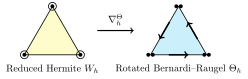

Plate Bending with Nonconforming Elements and Reduction Operators
=================================================================

This demo computes the deflection of a thin elastic plate with three finite
element methods. A conforming method for the Kirchhoff plate needs an
:math:`H^2`-conforming element, such as the quintic Argyris element with 21
degrees of freedom on each triangle. The three methods in this demo use
cheaper, nonconforming spaces instead. Each method connects two of its spaces
with a *reduction operator* :math:`\Pi_h`. Before a field enters one term of
the energy, the reduction operator interpolates that field into a second finite
element space.

In Firedrake, a reduction operator is a :doc:`symbolic interpolation
<../interpolation>` that we write with :py:func:`~.interpolate` inside the
variational form. Both spaces are on the same mesh, so the form compiler applies
the interpolation inside each element kernel. Firedrake does not assemble a
global interpolation matrix.

The demo uses three reduction operators:

* :math:`\Pi_h^P` interpolates into the linear Lagrange space :math:`P_h`. It
  keeps the values at the vertices.
* :math:`\Pi_h^N` interpolates into the lowest-order Nédélec space
  :math:`\boldsymbol{N}_h`. It keeps the tangential moment on each edge.
* :math:`\Pi_h^\Theta` interpolates into the rotated Bernardi--Raugel space
  :math:`\boldsymbol{\Theta}_h`. It keeps the vector values at the vertices and
  the tangential moment on each edge.

The three methods differ in the field that they reduce, and thus in the order
of ``interpolate`` and ``grad`` in the form:

1. **MITC** for the Reissner--Mindlin plate reduces the shear strain,
   ``interpolate(grad(w) - beta, N)``.
2. **The modified Morley method** for a Kirchhoff plate under in-plane tension
   reduces the deflection in the membrane term, ``grad(interpolate(w, P))``.
3. **The discrete Kirchhoff triangle** for the same plate reduces the gradient
   of the deflection in the bending term, ``grad(interpolate(grad(w), Theta))``.
   It uses the same membrane term as the modified Morley method.

At the end, we compare the convergence rates of the three methods.

The Clamped Plate
-----------------

All three methods compute the transverse deflection :math:`w` of a plate with
mid-surface :math:`\Omega = (0, 1)^2` under a transverse load :math:`f`. The
two Kirchhoff methods clamp the plate, that is, :math:`w` and its normal
derivative are zero on the boundary :math:`\partial \Omega`. The MITC method
uses the boundary deflection of its manufactured solution, which we derive in
the MITC section.

A rotation field :math:`\boldsymbol{\beta}` describes how the normals to the
mid-surface turn. Its bending energy is

.. math::

  \frac{1}{2} \int_\Omega \boldsymbol{\sigma}(\boldsymbol{\beta}) :
  \boldsymbol{\varepsilon}(\boldsymbol{\beta}) \, \mathrm{d}x, \qquad
  \boldsymbol{\sigma}(\boldsymbol{\beta}) = D \left( (1 - \nu)
  \boldsymbol{\varepsilon}(\boldsymbol{\beta}) + \nu \, \nabla \cdot \boldsymbol{\beta}
  \, \mathbf{I} \right),

where :math:`\boldsymbol{\varepsilon}(\boldsymbol{\beta})` is the symmetric
gradient and :math:`D = E t^3 / (12 (1 - \nu^2))` is the bending stiffness of a
plate of thickness :math:`t`, with Young's modulus :math:`E` and Poisson's ratio
:math:`\nu`. The Kirchhoff model assumes that the normals stay normal to the
deformed mid-surface. Thus :math:`\boldsymbol{\beta} = \nabla w`, and the
equilibrium equation is :math:`D \Delta^2 w = f`. The Reissner--Mindlin model
lets the normals turn independently of the mid-surface, so
:math:`\boldsymbol{\beta}` is a second unknown.

We begin by importing Firedrake and setting the material parameters of a
thin plate.

.. code-block:: python

  from firedrake import *

  t = Constant(0.01)
  E = Constant(1e3)
  nu = Constant(0.3)
  D = E * t**3 / (12 * (1 - nu**2))

All three methods use the bending form below, with trial rotation
:math:`\boldsymbol{\beta}` and test rotation :math:`\boldsymbol{\theta}`. The
methods differ only in what they substitute for the two rotations:

* MITC uses rotations that are unknowns independent of the trial and test
  deflections :math:`w` and :math:`v`.
* The modified Morley method uses :math:`\boldsymbol{\beta} = \nabla w` and
  :math:`\boldsymbol{\theta} = \nabla v`.
* The discrete Kirchhoff triangle uses
  :math:`\boldsymbol{\beta} = \Pi_h^\Theta \nabla w` and
  :math:`\boldsymbol{\theta} = \Pi_h^\Theta \nabla v`.

.. code-block:: python

  def sigma(beta):
      return D * ((1 - nu) * sym(grad(beta)) + nu * div(beta) * Identity(2))

  def bending(beta, theta):
      return inner(sigma(beta), sym(grad(theta))) * dx

To measure the convergence of each method, we use a manufactured Kirchhoff
solution :math:`w_K` that satisfies the clamped boundary conditions. Each
method calculates the load from :math:`w_K` symbolically.

.. code-block:: python

  def kirchhoff_solution(mesh):
      x, y = SpatialCoordinate(mesh)
      return x**2 * (1 - x)**2 * y**2 * (1 - y)**2

Each method calculates an approximation of the rotation, so we compare the
methods by the :math:`L^2` error of the rotation gradient
:math:`\nabla \boldsymbol{\beta}`. The exact rotation gradient is the Hessian
:math:`\nabla \nabla w_K`. The squared error is a polynomial of high degree, so
we integrate it with a quadrature rule of degree 14.

.. code-block:: python

  def l2_error(error):
      return sqrt(assemble(inner(error, error) * dx(degree=14)).real)

Reissner--Mindlin Plate with MITC
---------------------------------

The Reissner--Mindlin model has the total potential energy

.. math::

  \mathcal{E}(w, \boldsymbol{\beta}) =
  \frac{1}{2} \int_\Omega \left(
  \boldsymbol{\sigma}(\boldsymbol{\beta}) :
  \boldsymbol{\varepsilon}(\boldsymbol{\beta})
  + k_s G t \, | \nabla w - \boldsymbol{\beta} |^2 \right) \, \mathrm{d}x
  - \int_\Omega f w \, \mathrm{d}x,

where :math:`G = E / (2 (1 + \nu))` is the shear modulus, :math:`k_s` is the
shear correction factor, and :math:`\nabla w - \boldsymbol{\beta}` is the shear
strain. The bending stiffness :math:`D` scales as :math:`t^3`, but the shear
coefficient :math:`k_s G t` scales as :math:`t`. Relative to the bending term,
the shear term thus has a coefficient of order :math:`t^{-2}`. As
:math:`t \to 0`, the shear term becomes a penalty that enforces the Kirchhoff
constraint :math:`\boldsymbol{\beta} = \nabla w`. Low-order spaces cannot
satisfy this constraint exactly, so a standard discretisation *locks*: the
deflection tends to zero instead of to the Kirchhoff solution.

The Mixed Interpolation of Tensorial Components (MITC) method
:cite:`Bathe:1985,Brezzi:1989` prevents locking with a reduction of the shear
strain. It replaces the shear strain by its interpolant into the
:math:`H(\mathrm{curl})`-conforming Nédélec space :math:`\boldsymbol{N}_h`:

.. math::

  \bar{\boldsymbol{\gamma}}_h = \Pi_h^N (\nabla w_h - \boldsymbol{\beta}_h)
  = \nabla w_h - \Pi_h^N \boldsymbol{\beta}_h.

The second equality holds because the Lagrange and Nédélec interpolants
commute with the gradient, :math:`\Pi_h^N \nabla q = \nabla \Pi_h^P q`, and
because :math:`\Pi_h^P w_h = w_h` for a deflection :math:`w_h \in P_h`. The
reduced constraint :math:`\nabla w_h = \Pi_h^N \boldsymbol{\beta}_h` thus
restricts only the tangential edge moments of the rotation. This constraint
does not force the discrete deflection to zero, so the method does not lock.

The diagram shows the three element spaces:

.. image:: mitc_elements.svg
   :align: center

* `P1 <https://defelement.org/elements/lagrange.html>`__: the deflection space
  :math:`P_h`. Its degrees of freedom are the values at the vertices.
* `P1-iso-P2 <https://defelement.org/elements/p1-iso-p2.html>`__: the rotation
  space. This macroelement divides each triangle into four smaller triangles
  and uses vector linear Lagrange functions on each of them. The double dots
  show the two components of the vector value at a point.
* `Nédélec 1 <https://defelement.org/elements/nedelec1.html>`__: the space
  :math:`\boldsymbol{N}_h` of the reduction operator. The arrows show the
  tangential moments on the edges.

The P1-iso-P2 macroelement divides each edge in two, so a rotation is only
piecewise linear along an edge. To calculate the Nédélec edge moments of such
a rotation exactly, we select a composite quadrature rule on the divided edges
with ``quad_scheme="iso"``.

For the manufactured solution, we use the load :math:`f = D \Delta^2 w_K`. The
Reissner--Mindlin solution for this load is not :math:`w_K`. The rotation
:math:`\boldsymbol{\beta} = \nabla w_K` and the shear strain
:math:`\nabla w - \boldsymbol{\beta} = -D \nabla \Delta w_K / (k_s G t)`
balance the load, so the exact deflection is
:math:`w = w_K - D \Delta w_K / (k_s G t)`. This deflection is not zero on the
boundary, so we apply it as boundary data. The exact rotation is zero on the
boundary.

.. code-block:: python

  k_s = Constant(5 / 6)
  G = E / (2 * (1 + nu))

  def mitc(mesh):
      W = FunctionSpace(mesh, "Lagrange", 1)
      B = VectorFunctionSpace(mesh, "Lagrange", 1, variant="iso")
      R = FunctionSpace(mesh, "N1curl", 1, quad_scheme="iso")
      Z = W * B

      w, beta = TrialFunctions(Z)
      v, theta = TestFunctions(Z)

      a_bending = bending(beta, theta)
      a_shear = k_s * G * t * inner(interpolate(grad(w) - beta, R),
                                    interpolate(grad(v) - theta, R)) * dx
      a = a_bending + a_shear

      w_K = kirchhoff_solution(mesh)
      f = D * div(grad(div(grad(w_K))))
      L = inner(f, v) * dx

      w_exact = w_K - D * div(grad(w_K)) / (k_s * G * t)
      bcs = [DirichletBC(Z.sub(0), w_exact, "on_boundary"),
             DirichletBC(Z.sub(1), 0, "on_boundary")]

      z = Function(Z)
      solve(a == L, z, bcs=bcs)
      w_h, beta_h = z.subfunctions
      return w_h, l2_error(grad(beta_h) - grad(grad(w_K)))

Kirchhoff Plate with the Modified Morley Method
-----------------------------------------------

The second and third methods discretise the Kirchhoff model. To show how a
reduction operator can keep a method robust in a singular limit, we also apply
a uniform in-plane tension :math:`T` per unit length to the plate. The tension
adds a membrane term to the total potential energy:

.. math::

  \mathcal{E}(w) =
  \frac{1}{2} \int_\Omega \left(
  \boldsymbol{\sigma}(\nabla w) : \boldsymbol{\varepsilon}(\nabla w)
  + T |\nabla w|^2 \right) \, \mathrm{d}x
  - \int_\Omega f w \, \mathrm{d}x.

We choose the tension :math:`T = E t / (12 (1 - \nu^2))`, so that
:math:`D / T = t^2`. The scaled deflection :math:`u = T w` then satisfies

.. math::

  t^2 \Delta^2 u - \Delta u = f.

As :math:`t \to 0`, the solution tends to the solution :math:`u^0` of the
membrane equation :math:`-\Delta u^0 = f`. A method that is robust for thin
plates must also approximate this membrane limit.

The Morley element :cite:`Morley:1968` is the smallest triangular element for
the bending term. Let :math:`V_h` be the space of piecewise quadratic Morley
functions on the triangulation of :math:`\Omega`. Two Morley functions on
neighbouring triangles agree at the shared vertices, and they have the same
mean normal derivative on the shared edge. For the clamped plate, the values
at the boundary vertices and the mean normal derivatives on the boundary edges
are zero.

These conditions are sufficient for the bending term, but not for the
membrane term. Morley functions are not continuous across edges, and below we
show that the Morley method does not converge in the membrane limit. The
modified Morley method of Wang, Xu and Hu :cite:`Wang:2006` keeps the Morley
element in the bending term. In the membrane term and in the load, it replaces
:math:`w_h` by its interpolant :math:`\Pi_h^P w_h` into the linear Lagrange
space :math:`P_h`:

.. math::

  \int_\Omega \boldsymbol{\sigma}(\nabla w_h) : \boldsymbol{\varepsilon}(\nabla v_h)
  \, \mathrm{d}x
  + \int_\Omega T \, \nabla \Pi_h^P w_h \cdot \nabla \Pi_h^P v_h \, \mathrm{d}x
  = \int_\Omega f \, \Pi_h^P v_h \, \mathrm{d}x \qquad \forall v_h \in V_h,

where we calculate the gradients of the Morley functions on each cell. As
:math:`t \to 0`, the bending term becomes small relative to the membrane term,
and the form divided by :math:`T` depends only on :math:`\Pi_h^P w_h`. In this
limit, the method is the linear Lagrange discretisation of the membrane
equation: the scaled interpolant :math:`T \Pi_h^P w_h` tends to the linear
Lagrange solution of :math:`-\Delta u = f`. Many Morley functions have the same
interpolant, so the limiting form is singular on :math:`V_h`, but the limit of
the interpolant is unique.

.. image:: morley_elements.svg
   :align: center

* `Morley <https://defelement.org/elements/morley.html>`__: the deflection
  space :math:`V_h`. Its degrees of freedom are the values at the vertices and
  the mean normal derivatives on the edges, which the arrows show.
* `P1 <https://defelement.org/elements/lagrange.html>`__: the space
  :math:`P_h` of the reduction operator. :math:`\Pi_h^P` keeps the values of a
  Morley function at the vertices and discards its normal derivatives.

The Morley degrees of freedom on the boundary are the values at the boundary
vertices and the mean normal derivatives on the boundary edges. The boundary
condition on :math:`V_h` sets these degrees of freedom to zero, and this clamps
the plate. With ``reduced=False``, the function below omits :math:`\Pi_h^P` and
gives the standard Morley discretisation, which we use for comparison.

.. code-block:: python

  def modified_morley_problem(mesh, T, f, reduced=True):
      V = FunctionSpace(mesh, "Morley", 2)
      P = FunctionSpace(mesh, "Lagrange", 1)

      w = TrialFunction(V)
      v = TestFunction(V)
      if reduced:
          Pi_w = interpolate(w, P)
          Pi_v = interpolate(v, P)
      else:
          Pi_w = w
          Pi_v = v

      a_bending = bending(grad(w), grad(v))
      a_membrane = T * inner(grad(Pi_w), grad(Pi_v)) * dx
      a = a_bending + a_membrane
      L = inner(f, Pi_v) * dx

      w_h = Function(V)
      bcs = DirichletBC(V, 0, "on_boundary")
      return LinearVariationalProblem(a, L, w_h, bcs=bcs)

We first check the membrane limit with the uniform load :math:`f = 1`. We
calculate the linear Lagrange solution of :math:`-\Delta u = f` once, and we
compare it with :math:`T \Pi_h^P w_h` for decreasing thickness. The tension
:math:`T` is an expression of the ``Constant`` :math:`t`, so one solver can
solve the plate problem for all thicknesses. We store the original thickness,
so that we can restore it for the convergence study.

.. code-block:: python

  mesh = UnitSquareMesh(16, 16)
  P = FunctionSpace(mesh, "Lagrange", 1)
  p = TrialFunction(P)
  q = TestFunction(P)
  f = Constant(1.0)

  a = inner(grad(p), grad(q)) * dx
  L = inner(f, q) * dx
  w_membrane = Function(P)
  solve(a == L, w_membrane, bcs=DirichletBC(P, 0, "on_boundary"))
  membrane_norm = norm(w_membrane).real

  reference_thickness = float(t)
  T = E * t / (12 * (1 - nu**2))
  plate_solver = LinearVariationalSolver(modified_morley_problem(mesh, T, f))
  for thickness in [1e-1, 1e-2, 1e-3]:
      t.assign(thickness)
      w_h = plate_solver.solve()

      scaled_w_h = assemble(interpolate(T * w_h, P))
      difference = errornorm(w_membrane, scaled_w_h).real / membrane_norm
      print(f"Modified Morley: t = {thickness:.0e}, "
            f"relative difference from the membrane = {difference:.2e}")

For small :math:`t`, the difference decreases as :math:`O(t^2)`.

.. code-block:: python

  assert difference < 1e-3

Without the reduction operator, the Morley method does not converge in the
membrane limit. A Morley function is continuous at the vertices, so its jump
across an interior edge is a quadratic that is zero at the two vertices. Such
a quadratic does not have zero mean. Thus the Morley discretisation of the
membrane term has a consistency error that does not decrease as the mesh is
refined :cite:`Nilssen:2001`. To show this, we set :math:`t = 10^{-4}`. This
thickness is much smaller than the mesh size, so the membrane term dominates
the energy. We use the manufactured solution :math:`w_K` with the load
:math:`f = D \Delta^2 w_K - T \Delta w_K`, and we measure the error in the
gradient of the deflection on each cell.

.. code-block:: python

  import numpy as np

  def membrane_error(mesh, reduced):
      w_K = kirchhoff_solution(mesh)
      f = D * div(grad(div(grad(w_K)))) - T * div(grad(w_K))
      problem = modified_morley_problem(mesh, T, f, reduced=reduced)
      w_h = LinearVariationalSolver(problem).solve()
      return l2_error(grad(w_h) - grad(w_K))

  t.assign(1e-4)
  sizes = [4, 8, 16, 32]
  for reduced, name in [(False, "Morley"), (True, "Modified Morley")]:
      errors = np.array([membrane_error(UnitSquareMesh(size, size), reduced)
                         for size in sizes])
      rates = np.log2(errors[:-1] / errors[1:])
      print(f"{name}: errors = {errors}, rates = {rates}")
      if reduced:
          assert rates[-1] > 1.5, rates
      else:
          assert errors[-1] > 0.9 * errors[0], errors

The demo prints the following errors and rates:

.. table:: Gradient errors at :math:`t = 10^{-4}`
   :align: center
   :class: column-pairs
   :widths: 1 3 2 3 2

   +----+------------------+------------------+
   |    | Morley           | Modified Morley  |
   +    +-----------+------+-----------+------+
   | n  | error     | rate | error     | rate |
   +====+===========+======+===========+======+
   | 4  | 6.055e-03 | --   | 3.782e-03 | --   |
   +----+-----------+------+-----------+------+
   | 8  | 7.400e-03 | -0.29| 1.526e-03 | 1.31 |
   +----+-----------+------+-----------+------+
   | 16 | 7.872e-03 | -0.09| 4.623e-04 | 1.72 |
   +----+-----------+------+-----------+------+
   | 32 | 7.999e-03 | -0.02| 1.246e-04 | 1.89 |
   +----+-----------+------+-----------+------+

The error of the Morley method does not decrease as the mesh is refined. The
error of the modified Morley method decreases at a rate that approaches 2. The
two methods differ only in the reduction operator, so the reduction operator
makes the method converge.

For the convergence study, we restore the original thickness. We keep the load
:math:`f = D \Delta^2 w_K - T \Delta w_K`, so the exact solution is still
:math:`w_K`. The rotation of the Morley method is :math:`\nabla w_h`, so its
rotation gradient is the Hessian of :math:`w_h` on each cell.

.. code-block:: python

  t.assign(reference_thickness)

  def plate_under_tension(mesh):
      w_K = kirchhoff_solution(mesh)
      f = D * div(grad(div(grad(w_K)))) - T * div(grad(w_K))
      problem = modified_morley_problem(mesh, T, f)
      w_h = LinearVariationalSolver(problem).solve()
      return w_h, l2_error(grad(grad(w_h)) - grad(grad(w_K)))

Kirchhoff Plate with Discrete Kirchhoff Triangles
-------------------------------------------------

The modified Morley method uses the cellwise gradient :math:`\nabla w_h` as
the rotation in the bending term. The discrete Kirchhoff triangle (DKT) of
Batoz, Bathe and Ho :cite:`Batoz:1980` uses a continuous rotation instead. It
replaces :math:`\nabla w_h` by the discrete gradient
:math:`\nabla_h^\Theta w_h = \Pi_h^\Theta \nabla w_h`, which is in the
continuous rotated Bernardi--Raugel space :math:`\boldsymbol{\Theta}_h`. The
deflection :math:`w_h` is in the reduced Hermite space :math:`W_h`, which we
describe below. For the membrane term and the load, DKT uses the same
reduction :math:`\Pi_h^P` as the modified Morley method. The DKT energy with
the membrane term is

.. math::

  \mathcal{E}_h(w_h) =
  \frac{1}{2} \int_\Omega \boldsymbol{\sigma}(\nabla_h^\Theta w_h) :
  \boldsymbol{\varepsilon}(\nabla_h^\Theta w_h) \, \mathrm{d}x
  + \frac{1}{2} \int_\Omega T |\nabla \Pi_h^P w_h|^2 \, \mathrm{d}x
  - \int_\Omega f \Pi_h^P w_h \, \mathrm{d}x,

and its equilibrium equation is

.. math::

  \int_\Omega \boldsymbol{\sigma}(\nabla_h^\Theta w_h) :
  \boldsymbol{\varepsilon}(\nabla_h^\Theta v_h) \, \mathrm{d}x
  + \int_\Omega T \, \nabla \Pi_h^P w_h \cdot \nabla \Pi_h^P v_h \, \mathrm{d}x
  = \int_\Omega f \Pi_h^P v_h \, \mathrm{d}x
  \qquad \forall v_h \in W_h.

As for the modified Morley method, the membrane limit of this equation is the
linear Lagrange discretisation of :math:`-\Delta u = f`. In UFL, the bending
term contains ``grad(interpolate(grad(w), Theta))`` and the membrane term
contains ``grad(interpolate(w, P))``.

* **Reduced Hermite**: the deflection space :math:`W_h`. Its degrees of
  freedom are the values (dots) and the gradients (circles) at the vertices.
  The cubic `Hermite <https://defelement.org/elements/hermite.html>`__
  element also has the value at the barycentre. One constraint on the cubic
  polynomials removes this degree of freedom.
* **Rotated Bernardi--Raugel**: the rotation space
  :math:`\boldsymbol{\Theta}_h`. It contains the vector linear Lagrange
  functions and, on each edge, one quadratic bubble that points along the edge.
  Its degrees of freedom are the vector values at the vertices (double dots)
  and the tangential moments on the edges (arrows). The
  `Bernardi--Raugel <https://defelement.org/elements/bernardi-raugel.html>`__
  element for Stokes flow has bubbles that point normal to the edges.

The gradient of a reduced Hermite function has one value at each vertex, and
its tangential component on an edge is the same on the two neighbouring cells.
:math:`\Pi_h^\Theta` uses only these quantities, so the discrete gradient is
continuous across the edges.

The boundary condition on :math:`W_h` sets the values and the gradients at the
boundary vertices to zero. The discrete gradient of the solution is then zero
on the boundary, and this clamps the plate.

.. code-block:: python

  def discrete_kirchhoff(mesh):
      W = FunctionSpace(mesh, "Reduced-Hermite", 3)
      Theta = FunctionSpace(mesh, "Rotated-Bernardi-Raugel", 1)
      P = FunctionSpace(mesh, "Lagrange", 1)

      w = TrialFunction(W)
      v = TestFunction(W)
      discrete_grad_w = interpolate(grad(w), Theta)
      discrete_grad_v = interpolate(grad(v), Theta)
      Pi_w = interpolate(w, P)
      Pi_v = interpolate(v, P)

      a_bending = bending(discrete_grad_w, discrete_grad_v)
      a_membrane = T * inner(grad(Pi_w), grad(Pi_v)) * dx
      a = a_bending + a_membrane

      w_K = kirchhoff_solution(mesh)
      f = D * div(grad(div(grad(w_K)))) - T * div(grad(w_K))
      L = inner(f, Pi_v) * dx

      w_h = Function(W)
      solve(a == L, w_h, bcs=DirichletBC(W, 0, "on_boundary"))
      beta_h = interpolate(grad(w_h), Theta)
      return w_h, l2_error(grad(beta_h) - grad(grad(w_K)))

Convergence Rates
-----------------

We solve the three problems on a sequence of uniformly refined meshes. For
each method, we print the rotation gradient errors and the rates of
convergence between successive meshes.

.. code-block:: python

  methods = {"MITC": mitc,
             "Modified Morley": plate_under_tension,
             "Discrete Kirchhoff": discrete_kirchhoff}
  sizes = [4, 8, 16, 32]
  errors = {name: [] for name in methods}
  solutions = {}
  for size in sizes:
      mesh = UnitSquareMesh(size, size)
      for name, method in methods.items():
          solutions[name], error = method(mesh)
          errors[name].append(error)

  print(f"{'n':>4}" + "".join(f"{name:>20}{'rate':>6}" for name in methods))
  for i, size in enumerate(sizes):
      row = f"{size:4d}"
      for name in methods:
          rate = f"{np.log2(errors[name][i - 1] / errors[name][i]):.2f}" if i else "--"
          row += f"{errors[name][i]:20.3e}{rate:>6}"
      print(row)

The demo prints the following errors and rates:

.. table:: Rotation gradient errors and convergence rates
   :align: center
   :class: column-pairs
   :widths: 1 3 2 3 2 3 2

   +----+------------------+------------------+--------------------+
   |    | MITC             | Modified Morley  | Discrete Kirchhoff |
   +    +-----------+------+-----------+------+-----------+--------+
   | n  | error     | rate | error     | rate | error     | rate   |
   +====+===========+======+===========+======+===========+========+
   | 4  | 4.260e-02 | --   | 4.519e-02 | --   | 2.453e-02 | --     |
   +----+-----------+------+-----------+------+-----------+--------+
   | 8  | 3.002e-02 | 0.50 | 3.127e-02 | 0.53 | 1.290e-02 | 0.93   |
   +----+-----------+------+-----------+------+-----------+--------+
   | 16 | 1.711e-02 | 0.81 | 1.808e-02 | 0.79 | 6.516e-03 | 0.99   |
   +----+-----------+------+-----------+------+-----------+--------+
   | 32 | 8.992e-03 | 0.93 | 9.602e-03 | 0.91 | 3.261e-03 | 1.00   |
   +----+-----------+------+-----------+------+-----------+--------+

For all three methods, the rate approaches 1 as the mesh is refined. In each
method, the rotation is piecewise linear, apart from the edge bubbles of
:math:`\boldsymbol{\Theta}_h`, so first order is the optimal rate for the
rotation gradient.

.. code-block:: python

  for name in methods:
      rate = np.log2(errors[name][-2] / errors[name][-1])
      assert rate > 0.85, (name, rate)

Finally, we draw a surface plot of the discrete Kirchhoff deflection on the
finest mesh with :func:`trisurf <firedrake.pyplot.trisurf>`.

.. code-block:: python

  import matplotlib.pyplot as plt
  from firedrake.pyplot import trisurf

  fig = plt.figure()
  axes = fig.add_subplot(projection="3d")
  trisurf(solutions["Discrete Kirchhoff"], axes=axes)
  axes.set_xlabel("$x$")
  axes.set_ylabel("$y$")
  axes.set_zlabel("$w$", labelpad=12)
  fig.savefig("plate_bending.png", bbox_inches="tight")

.. figure:: plate_bending.png
   :align: center
   :alt: Surface plot of the deflection of the clamped plate.

A Python script version of this demo can be found :demo:`here <plate_bending.py>`.

.. rubric:: References

.. bibliography:: demo_references.bib
   :filter: docname in docnames
